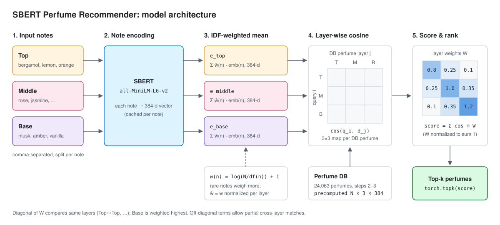

# Perfume Recommendation with SBERT

Recommends perfumes with similar Top / Middle / Base notes, using SBERT note embeddings.



## How it works

1. Each note is embedded with SBERT (`all-MiniLM-L6-v2`, 384-d).
2. Notes in each layer are averaged with IDF weights (`log(N / df) + 1`), so rare notes count more. A perfume becomes a `3 × 384` matrix.
3. Cosine similarity between every query layer and DB layer gives a `3 × 3` map.
4. The map is weighted by the layer matrix `W` and summed into a score; the top-k perfumes are returned.

```
W = [[0.8,  0.25, 0.1 ],   # Top
     [0.25, 1.0,  0.35],   # Middle
     [0.1,  0.35, 1.2 ]]   # Base  (normalized to sum 1)
```

## Data

`fra_cleaned.csv`: 24,063 perfumes cleaned from the [Fragrantica dataset on Kaggle](https://www.kaggle.com/datasets/olgagmiufana1/fragrantica-com-fragrance-dataset).

## Files

| File | Description |
|---|---|
| `perfume_recommendation_v2.py` | Recommender with precomputed DB embeddings; supports custom note queries |
| `Perfume_Recommendation.py` | First version (loops over the DB per query, slow) |
| `evaluate.py` | Hit@K, MRR, brand/gender consistency, note overlap |
| `optimize_weights.py` | Tunes `W` to maximize Hit@1 (Nelder-Mead) |
| `functions.py` | IDF weight calculation |
| `PERFUME_RECOMMENDATION.ipynb` | Experiment notebook |

## Usage

Run from this directory (the CSV path is relative).

```bash
pip install -r requirements.txt
```

```bash
python perfume_recommendation_v2.py
```

To search with your own notes, edit `query_notes` in `perfume_recommendation_v2.py`. Notes must exist in the dataset.

## Limitations

- Perfumes with identical notes tie in score.
- Perfumes are identified by name, and some names are duplicated (22,840 unique of 24,063).
- Only note composition is used; ratings and accords are ignored.
